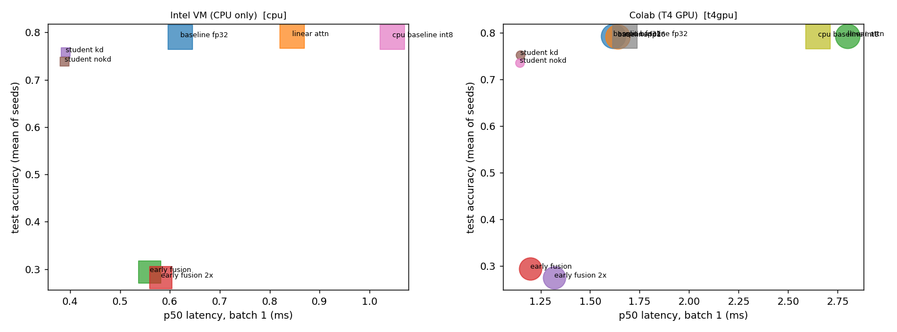

# Week-05-Latency-Memory-Accuracy-A-Measured-Trade-off-Board-for-Quantization-Distillation-and-Fusion
Latency, Memory, Accuracy: A Measured Trade-off Board for Quantization, Distillation, and Fusion

Brightline Logistics scouting study: which small model should ship to in-cab Android tablets that read scanned bills of lading and short spoken driver notes? This repo answers with measurements from one free GPU (and an Intel VM for comparison): up to nine configurations of a small two-modality model (seven on a CPU-only machine, where FP16 and the separate CPU baseline do not apply), benchmarked with warm-up, device synchronization, fixed seeds and repeated trials, recorded in an Excel workbook, plus a scaling-law compute estimate for a 10x larger version.

| Technique | Where |
|---|---|
| Baseline (late fusion, softmax attention) | `baseline_fp32`, `cpu_baseline_fp32` |
| Architecture variant (linear attention) | `linear_attn` |
| Quantization (dynamic INT8 on CPU, FP16 on GPU) | `cpu_baseline_int8`, `baseline_fp16` |
| Distillation (student with KD, plus a labels-only control) | `student_kd`, `student_nokd` |
| Fusion (early vs late, early also at 2x epochs) | `early_fusion`, `early_fusion_2x` vs the baseline |
| Scaling law (6ND, Chinchilla token budget, 10x projection) | `ScalingLaw` sheet in the workbook |

## Quick start

| Where | How |
|---|---|
| **Google Colab T4** (graded run) | *Runtime → Change runtime type → T4 GPU*, upload the notebook (its first cell clones this repo once and is safe to re-run), then *Run all*. At the end it asks whether to write the Intel-VM vs T4 comparison into this README and push it with a fine-grained token. Full guide: [COLAB.md](COLAB.md) |
| **Windows** | `powershell -ExecutionPolicy Bypass -File .\Install-Assignment_05_Tradeoff_Board_Windows.ps1` |
| **macOS** | Double-click `Install-Assignment_05_Tradeoff_Board_macOS.command` (first time: right-click → Open, or `chmod +x` it) |

Both installers find Python 3.10+, create a project-local `.venv`, and run `env_setup.py`. That script detects the
imports in the assignment script and its helpers, installs whatever is missing and reports the device and host. The
installers then offer a **quick smoke test** (~1–2 min, numbers not meaningful) or the **full run** (~20–30 min on CPU).
Unattended: add `-Launch none|quick|full` on Windows, or set `LAUNCH=none|quick|full` on macOS.

### Environment detection (`env_setup.py`)

The notebook's first cell is `env_setup.py`, inlined by `scripts/build_notebook.py`, so the notebook runs on Colab
with nothing else uploaded. It tells these machines apart and labels every result with what it was measured on:

| `host_class` | Detected as | Results tag |
|---|---|---|
| `colab-t4` | Colab, and the T4 is confirmed through both `nvidia-smi` and `torch.cuda` (name, VRAM, sm_75) | `t4gpu` |
| `colab-gpu` / `colab-cpu` | Colab with a different GPU / on a CPU runtime (it prints how to switch to a T4) | `gpu` / `cpu` |
| `intel-vm` | Intel CPU in a **virtual machine**: Windows `Win32_ComputerSystem` model, Linux DMI / `systemd-detect-virt`, macOS `kern.hv_vmm_present` | `cpu` |
| `intel-host`, `apple-silicon` | Physical Intel PC / Apple-silicon Mac | `cpu` |

It also installs **only missing** packages (it never reinstalls Colab's CUDA torch), warns when `nvidia-smi` sees a GPU
that torch can't use (a CPU wheel installed over the CUDA build), and writes a hardware manifest (GPU, VRAM, driver, CPU
model, RAM, VM product, package versions) next to the results. `setup(require_t4=True)` refuses to run anywhere but a T4.

## Evaluation sets

Every configuration is benchmarked on two sets, with the same code, seeds and budgets:

| Set | What it is | Labels |
|---|---|---|
| **Synthetic** (generated in `scripts/Assignment_05_Tradeoff_Board.py`, Step 3) | A rendered bill-of-lading image plus a driver-note transcript, 8,000 train / 2,000 test, noise and decoys on both inputs | Cargo condition (from the image) x receiver outcome (from the note); 6 classes |
| **Public** (`scripts/public_data.py`) | Real photos with human captions: Hugging Face [`intro/flickr8k`](https://huggingface.co/datasets/intro/flickr8k), license declared CC0-1.0 on the dataset card; 2,836 train / 884 held-out photos from the official splits | **Derived by me**: the scene category (dog, water, snow/mountain, ball sport, street/crowd, child) whose keywords occur most often in captions 1-4. Caption 0 is the text input and is never read by the label rule |

The public set is a check that the ranking of techniques holds on real photos and real language. It is not a document-classification
result: the labels are weak (caption keywords), text alone is already informative (a plain keyword rule on caption 0 scores 0.738 on
the held-out photos; chance is 0.167), and the photos are everyday scenes, not scanned bills. Accuracies are not comparable across the
two sets. The exact photos used are listed in `results/public_subset.csv`. A plain *Run all* produces both sets (the public set runs as
a second pass); `BOARD_SKIP_PUBLIC=1` skips it.

## Measurement protocol

- **Warm-up** before every timed trial; **`torch.cuda.synchronize()`** before and after every timed forward on GPU.
- **Repeated trials** (5 × 300 forwards at batch size 1): p50, p95, mean and std per trial, then the spread *between* trials.
- **Interleaved order**: configs are visited in shuffled order in each trial round, so drift (GPU boost clocks, noisy neighbours,
  VM scheduling) hits all configs alike.
- **Memory**: GPU peak is `max_memory_allocated` on a fresh load of each config alone, with everything else parked on the CPU first.
  CPU memory is serialized model size plus a coarse RSS delta.
- **Accuracy**: three training seeds, one fixed test set, binomial 95% interval for test-set sampling error.
- **Fixed seeds** everywhere; the synthetic data uses its own fixed seed so every config sees identical examples.

Limits are listed in the workbook's `Methodology` sheet: synthetic data, text transcripts instead of audio (no ASR error is
measured), neither machine is the tablet, and a shared free GPU makes absolute latencies vary between sessions.

<!-- RESULTS:BEGIN -->
<!-- Generated by scripts/update_readme.py from results/*.json; edits inside these markers are overwritten. -->
## Results: Intel VM vs Colab T4

Same code, same seeds, same budgets on every machine. **Accuracy should agree across hardware** (small drift comes from floating-point order); **latency and memory are what the hardware changes.** On the T4 run, GPU configs execute on the T4 and the `cpu_*` rows on Colab's 2-vCPU CPU; on the VM everything runs on the CPU. Full detail, every run, formulas and the scaling-law sheet: `results/Week05_Benchmark_Workbook.xlsx`.

### Hardware

| | Intel VM · CPU only | Colab · T4 GPU |
|---|---:|---:|
| Device | CPU only: 13th Gen Intel(R) Core(TM) i9-13900HX, 16 logical cores (virtual machine) | Tesla T4 (14.6 GB, sm_75) |
| Host class | `intel-vm` | `colab-t4` |
| Platform / Python | windows / 3.14.7 | colab / 3.13.15 |
| torch | `2.14.1+cpu` | `2.11.0+cu130` |
| **Total notebook runtime** (synthetic set) | 1,177.5 s | 298.7 s |

### Board: synthetic set (generated here)

| Config | Intel VM · CPU only | Colab · T4 GPU |
|---|---:|---:|
| **Accuracy (mean ± seed std)** | | |
| `baseline_fp32` | 0.789 ± 0.013 | 0.793 ± 0.014 |
| `linear_attn` | 0.792 ± 0.013 | 0.793 ± 0.013 |
| `early_fusion` | 0.294 ± 0.009 | 0.294 ± 0.009 |
| `early_fusion_2x` | 0.282 ± 0.014 | 0.275 ± 0.003 |
| `student_kd` | 0.758 ± 0.009 | 0.753 ± 0.015 |
| `student_nokd` | 0.738 ± 0.006 | 0.736 ± 0.007 |
| `cpu_baseline_int8` | 0.790 ± 0.013 | 0.792 ± 0.013 |
| `baseline_fp16` | – | 0.792 ± 0.013 |
| `cpu_baseline_fp32` | – | 0.793 ± 0.014 |
| **p50 / p95 latency, ms (batch 1)** | | |
| `baseline_fp32` | 0.620 / 0.894 | 1.504 / 2.208 |
| `linear_attn` | 0.846 / 1.245 | 2.619 / 3.569 |
| `early_fusion` | 0.559 / 0.804 | 1.190 / 1.576 |
| `early_fusion_2x` | 0.582 / 0.880 | 1.191 / 1.416 |
| `student_kd` | 0.391 / 0.600 | 1.208 / 1.519 |
| `student_nokd` | 0.388 / 0.609 | 1.207 / 1.632 |
| `cpu_baseline_int8` | 1.046 / 1.553 | 2.133 / 3.075 |
| `baseline_fp16` | – | 1.723 / 2.322 |
| `cpu_baseline_fp32` | – | 2.122 / 3.494 |
| **Model size (MB) / peak GPU memory above floor (MB)** | | |
| `baseline_fp32` | 0.543 / n/a | 0.543 / 1.695 |
| `linear_attn` | 0.543 / n/a | 0.543 / 1.695 |
| `early_fusion` | 0.447 / n/a | 0.448 / 1.812 |
| `early_fusion_2x` | 0.447 / n/a | 0.448 / 1.812 |
| `student_kd` | 0.046 / n/a | 0.047 / 1.142 |
| `student_nokd` | 0.046 / n/a | 0.047 / 1.142 |
| `cpu_baseline_int8` | 0.244 / n/a | 0.244 / n/a |
| `baseline_fp16` | – | 0.280 / 0.912 |
| `cpu_baseline_fp32` | – | 0.543 / n/a |

### Board: public set (Flickr8k photos + human captions, derived labels)

Real photos with human captions from Hugging Face `intro/flickr8k` (license declared CC0-1.0). 2836 training and 884 held-out photos. The dataset has no class labels: the six scene classes are derived from captions 1–4 by a keyword rule, and caption 0 is the text input. A keyword rule on that text alone scores 0.738 (chance 0.167), so read this set as a check that the technique ranking holds on real data, not as a document-classification result. Accuracy is not comparable with the synthetic set.

| Config | Intel VM · CPU only |
|---|---:|
| **Accuracy (mean ± seed std)** | |
| `baseline_fp32` | 0.795 ± 0.008 |
| `linear_attn` | 0.794 ± 0.012 |
| `early_fusion` | 0.769 ± 0.015 |
| `early_fusion_2x` | 0.777 ± 0.010 |
| `student_kd` | 0.732 ± 0.007 |
| `student_nokd` | 0.739 ± 0.006 |
| `cpu_baseline_int8` | 0.795 ± 0.011 |
| **p50 / p95 latency, ms (batch 1)** | |
| `baseline_fp32` | 0.630 / 0.925 |
| `linear_attn` | 0.852 / 1.151 |
| `early_fusion` | 0.567 / 0.847 |
| `early_fusion_2x` | 0.564 / 0.851 |
| `student_kd` | 0.396 / 0.630 |
| `student_nokd` | 0.399 / 0.632 |
| `cpu_baseline_int8` | 1.057 / 1.446 |
| **Model size (MB) / peak GPU memory above floor (MB)** | |
| `baseline_fp32` | 0.722 / n/a |
| `linear_attn` | 0.722 / n/a |
| `early_fusion` | 0.626 / n/a |
| `early_fusion_2x` | 0.626 / n/a |
| `student_kd` | 0.091 / n/a |
| `student_nokd` | 0.091 / n/a |
| `cpu_baseline_int8` | 0.423 / n/a |



<!-- RESULTS:END -->

## Repository layout

```text
Assignment_05_Tradeoff_Board_Colab.ipynb        Colab notebook (built from the script; env_setup inlined)
Install-Assignment_05_Tradeoff_Board_Windows.ps1
Install-Assignment_05_Tradeoff_Board_macOS.command
env_setup.py              environment detection (Colab T4 / Intel VM / Mac), missing-package install, hardware snapshot
COLAB.md                  step-by-step T4 run and how to bring results back
requirements.txt          known-good versions (record only; not for Colab)
scripts/
  Assignment_05_Tradeoff_Board.py             full script: SCRIPT DETAILS region, Step 1-14 banners with
                                              explanations and reference links (single source)
  Assignment_05_Tradeoff_Board_Simplified.py  same code, banners/explanations/references stripped
  public_data.py          loads the public Flickr8k subset and derives its labels (photos cached under data/, gitignored)
  build_workbook.py       results/*.json -> Excel workbook (Board, Acc_Runs, Latency_Runs, ScalingLaw, ...)
  build_notebook.py       regenerates the .ipynb and the _Simplified.py from the full script
  update_readme.py        writes the comparison into this README and optionally pushes it
data/                     downloaded public-set photos (gitignored; rebuilt by scripts/public_data.py)
results/                  results_<tag>.json (tags t4gpu, cpu, and t4gpu_public, cpu_public for the public set), public_subset.csv, manifest_<tag>.json, *_runs_<tag>.csv, Week05_Benchmark_Workbook.xlsx
docs/video_outline.md     speaker notes for the video walkthrough
```
